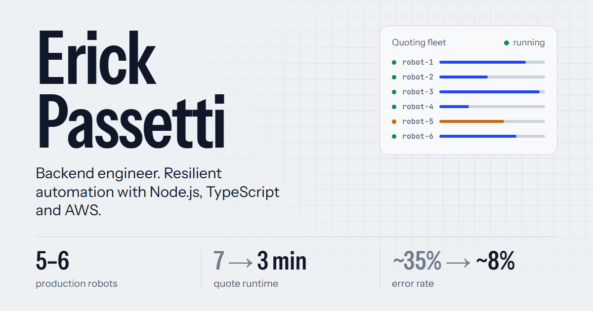

# Erick Passetti, Backend Engineer

[](https://passetti-cmd.github.io/erick-portfolio/)

My personal portfolio: **[passetti-cmd.github.io/erick-portfolio](https://passetti-cmd.github.io/erick-portfolio/)**

I build and run backend automation in production: a fleet of Playwright robots (Node.js, TypeScript) that quote health insurance across Brazilian insurer portals, monitored on AWS. This site shows that work, my side projects and how to reach me, in English and Portuguese.

## What's in it

- **Animated system diagram in the hero.** A simplified schematic of the quoting fleet: requests flow in, robots work their lanes, one hits a changed selector and retries, results go to S3 and logs to CloudWatch.
- **Before → after metrics.** Runtime and error-rate figures count down while a bar shrinks to the new value.
- **English / Portuguese.** A toggle in the nav switches all content and remembers the choice.
- **Light and dark themes.** Follows the system setting, with a manual toggle that persists.
- **Prerendered pages.** Every route is rendered to static HTML at build time, so search engines and link previews (LinkedIn, WhatsApp, Slack) see real content and per-page titles.
- **Accessible motion.** Animations respect `prefers-reduced-motion`, focus states are visible and the layout works down to phone width.

## Stack

| | |
| --- | --- |
| UI | React 18, TypeScript, Tailwind CSS |
| Motion | [Motion](https://motion.dev) (`motion/react`), SVG SMIL for the schematic |
| Routing | React Router 6 |
| Build | Vite 5, plus a small SSR prerender step |
| Type | Instrument Sans (variable width axis), JetBrains Mono |
| Hosting | GitHub Pages, deployed by GitHub Actions on every push to `main` |

## Running it locally

Needs Node.js 18 or newer.

```bash
npm install
```

```bash
npm run dev
```

The dev server runs at `http://localhost:5173`. To check the real production output, prerendering included:

```bash
npm run build
```

```bash
npm run preview
```

The preview is served at `http://localhost:4173/erick-portfolio/`.

## How the build works

`npm run build` runs four steps:

1. `tsc` typechecks the project.
2. `vite build` bundles the client into `dist/`.
3. `vite build --ssr src/entry-server.tsx` builds a server renderer into `dist-server/`.
4. `node scripts/prerender.mjs` renders each route to HTML, writes per-page `<title>`, description, Open Graph and canonical tags, generates `404.html` and `sitemap.xml`, then deletes `dist-server/`.

In the browser, `src/main.tsx` hydrates the prerendered HTML when it exists and falls back to a normal client render in dev.

## Project structure

```
src/
├── content/
│   ├── profile.ts      English content: profile, metrics, jobs, skills, education
│   ├── projects.ts     English project list and case-study text
│   ├── pt.ts           Portuguese versions of the two files above
│   ├── ui.ts           Interface strings in both languages
│   └── meta.ts         Page titles, descriptions and the routes to prerender
├── components/
│   ├── Hero.tsx            Name, intro, calls to action
│   ├── FleetSchematic.tsx  Animated architecture diagram and log ticker
│   ├── Metrics.tsx         Before → after figures
│   ├── Experience.tsx      Timeline that draws as you scroll
│   ├── Projects.tsx        Project list, with a slot for a featured project
│   ├── Skills.tsx, About.tsx, Education.tsx, Contact.tsx, Footer.tsx
│   ├── Navigation.tsx      Nav with active-section indicator and scroll progress
│   ├── LangToggle.tsx, ThemeToggle.tsx
│   └── ui.tsx              Shared section layout and display heading
├── pages/              Home, ProjectDetails, NotFound
├── i18n.tsx            Language provider and the useContent() hook
├── entry-server.tsx    Server renderer used by the prerender script
└── main.tsx            Client entry
scripts/prerender.mjs   Static HTML generation
public/                 Favicon, Open Graph image, CV files
```

## Editing content

All text lives in `src/content/`. Components don't hold copy.

- **A job, skill or certification:** edit `profile.ts` and the matching list in `pt.ts`.
- **A project:** add it to `projects.ts` and its Portuguese text to `projectTextPt` in `pt.ts`, using the same `id`. Set `featured: true` to show it in the large slot at the top of the section. Its detail page and prerendered HTML are created automatically.
- **Interface labels:** edit `ui.ts`. Both languages share the same keys, so TypeScript flags a missing translation.

## CV download

The "Download CV" buttons only appear when the files exist:

```
public/cv/Erick-Passetti-CV-EN.pdf
public/cv/Erick-Passetti-CV-PT.pdf   (optional; the Portuguese site falls back to the English file)
```

Vite checks for them at startup, so restart `npm run dev` after adding or removing a file.

## Deployment

`.github/workflows/deploy.yml` builds and publishes `dist/` to GitHub Pages on every push to `main`. The site is served from `/erick-portfolio/`. If the repository is renamed, update `base` in `vite.config.ts` and `SITE_URL` in `src/content/profile.ts`.

## Contact

- Email: erickpassetti23@gmail.com
- LinkedIn: [linkedin.com/in/erick-passetti](https://www.linkedin.com/in/erick-passetti)
- GitHub: [@Passetti-cmd](https://github.com/Passetti-cmd)

## License

MIT
